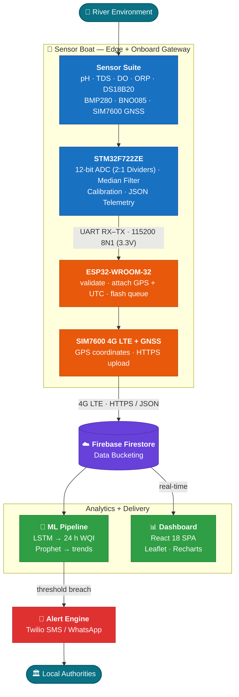
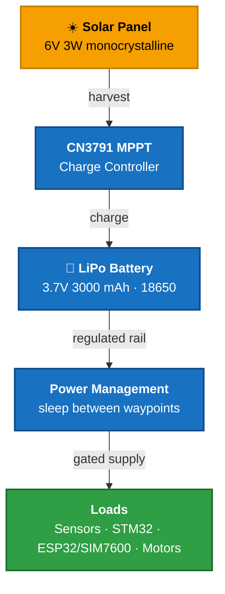
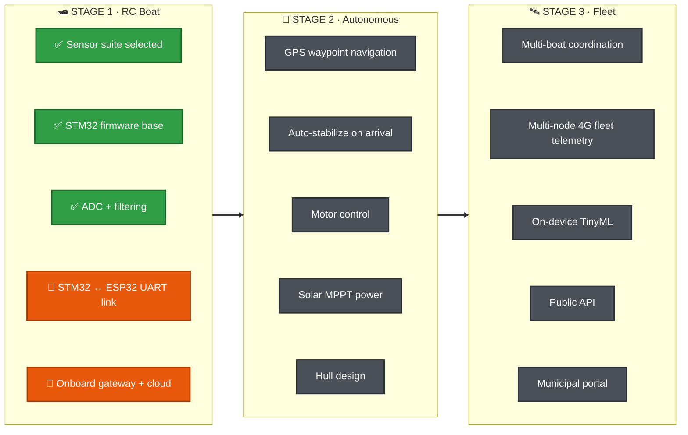

<div align="center">

<br>

# 🌊 WQM Project

### Real-Time River Water Quality Monitoring & Pollution Prediction

**A solar-powered sensor boat patrols Himalayan rivers, streams readings directly over 4G LTE,<br>and forecasts pollution 24 hours before it arrives.**

<br>

<p>
  
  
  
  
  
</p>

<p>
  <a href="https://github.com/WQM-Project/WQM"></a>
  <a href="https://github.com/WQM-Project/WQM/stargazers"></a>
  <a href="https://github.com/WQM-Project/WQM"></a>
</p>

<p>
  <a href="https://github.com/WQM-Project/WQM/blob/main/README.md"><b>📖 Full Spec</b></a> &nbsp;·&nbsp;
  <a href="https://github.com/WQM-Project/WQM/tree/main/Sensor_Readme"><b>📡 Hardware Docs</b></a> &nbsp;·&nbsp;
  <a href="https://github.com/WQM-Project/WQM/blob/main/Sensor_Readme/WQM_Sensor_BOM.md"><b>🧾 Bill of Materials</b></a>
</p>

<br>

</div>

---

## 🏔️ The Problem

The **Beas**, **Uhl**, and **Suketi** are losing ground to unmanaged construction runoff, tourism waste, and accelerated glacial melt.

The way we watch them hasn't kept up. Manual sampling catches one point in space and time. Lab turnaround takes days. Deep valleys have no Wi-Fi, patchy cellular, and no grid power for fixed stations.

**So pollution spikes get discovered after they've already moved downstream.**

## 🚀 Our Solution

An IoT boat that goes to the water instead of waiting for the water to reach a lab.

|  | |
|:-:|:--|
| 📡 | **Measures** 10 water-quality parameters with industrial-grade sensors, filtered and calibrated on the edge |
| 📶 | **Transmits** directly onboard — STM32 sends JSON over 3.3V UART RX–TX to an onboard ESP32 + SIM7600 4G LTE & GNSS module |
| 🤖 | **Predicts** the Water Quality Index 24 hours ahead with an LSTM trained on CPCB data |
| 🚨 | **Alerts** authorities via SMS and WhatsApp the moment thresholds break |

---

## 🏗️ System Architecture



---

## 📡 Sensor Suite

| Sensor | Model | Parameter | Range | Interface |
|:-------|:------|:----------|:------|:----------|
| 🧪 pH | robu.in Analog pH Kit (SEN0161 V1) | pH Level (`PH_SCALE=4.942f`, `PH_OFFSET=-2.713f`) | 0–14 pH (±0.1) | `PA3` (`ADC1_CH3`, 2:1 divider, 5V rail) |
| 💧 TDS | DFRobot SEN0244 | Dissolved Solids (`TDS_CAL_K=1.036f`) | 0–1000 ppm | `PA5` (`ADC1_CH5`, 2:1 divider) |
| 🌡️ Temperature | DS18B20 | Water Temp (`temp_w1`) | −55 to +125 °C (±0.5) | `PE6` (1-Wire, 4.7kΩ pull-up) |
| 🫧 Dissolved O₂ | Graylogix / DFRobot SEN0237-A | DO Concentration (7.5% KCl, air-cal `764 mV @ 24°C`) | 0–20 mg/L | `PA4` (`ADC1_CH4`, 2:1 divider) |
| 🔋 ORP | DFRobot SEN0165 | Redox Potential (`2.0V` midpoint, 20-sample trimmed mean) | ±2000 mV | `PC3` (`ADC1_CH13`, 2:1 divider, 5V rail) |
| 🌤️ Environment | BMP280 (`0x76`) | Air Temp + Barometric Pressure (DO comp; no RH) | ±1 hPa | `PB8 / PB9` (`I2C1`) |
| 🧭 IMU | BNO085 (`0x4A`) | Heading / Pitch / Roll | 9-DOF | `PB8 / PB9` (`I2C1`) |
| 📍 Location | SIM7600 GNSS *(+ optional NEO-M8N)* | GPS Coordinates / Fix / Speed / Course | — | Onboard ESP32 + SIM7600 *(optional STM32 `UART4`)* |
| 🌫️ Turbidity *(reserved)* | DFRobot SEN0189 | Suspended Solids (unfitted in current JSON) | 0–3000 NTU | `PC0` (`ADC1_CH10`, 2:1 divider) |
| ⚡ Conductivity *(reserved)* | DFRobot DFR0300 | EC (K=1, unfitted in current JSON) | 0–20 mS/cm | `PA6` (`ADC1_CH6`, 2:1 divider) |

---

## 🛠️ Tech Stack

<table>
<tr>
<td align="center" valign="top" width="20%">

**Edge / Firmware**

`STM32F722ZE`
`STM32CubeIDE`
`HAL Drivers`
`FreeRTOS`

</td>
<td align="center" valign="top" width="20%">

**Communication**

`UART RX–TX`
`ESP32-WROOM-32`
`SIM7600 4G + GNSS`
`AT Commands`

</td>
<td align="center" valign="top" width="20%">

**Cloud**

`Firebase`
`Firestore`
`Cloud Functions`
`Data Bucketing`

</td>
<td align="center" valign="top" width="20%">

**ML / Analytics**

`TensorFlow`
`Keras LSTM`
`FB Prophet`
`Python 3.10`

</td>
<td align="center" valign="top" width="20%">

**Frontend**

`React 18`
`Vite`
`Leaflet.js`
`Recharts`

</td>
</tr>
</table>

---

## 📊 Communication Protocol

```
┌─ STM32 → Onboard ESP32 UART JSON Line (115200 8N1, \n-terminated) ──────────────┐
│ {"id","ts","pH","tds_ppm","do_mgl","orp_mv","temp_w1","temp_air",               │
│  "pressure_hpa","lat","lon","alt_m","sog_knots","cog_deg","gps_fix",...} + \n   │
└─────────────────────────────────────────────────────────────────────────────────┘

   STM32 → ESP32     3.3V UART RX–TX @ 115200 8N1   Direct onboard wire + ACK/NAK
   ESP32 → Cloud     SIM7600 4G LTE HTTPS POST      Onboard GNSS fix + flash retry queue
```

## 🔋 Power Architecture



Entirely off-grid. Non-critical modules power down between waypoints.

---

## 🗺️ Roadmap



<div align="center">
<sub>✅ done · 🔄 in progress · ⬜ planned</sub>
</div>

> [!NOTE]
> **Hull design is open.** The mechanical platform for both boat stages is still under active development — hydrodynamic stability, a rigid probe mast, and battery volume for propulsion. This is a great place to jump in.

---

## 📦 Repositories

| Repository | Description | Status |
|:-----------|:------------|:-------|
| [**`WQM`**](https://github.com/WQM-Project/WQM) | Core firmware, sensor drivers, onboard UART → 4G telemetry, and full project documentation | 🟢 Active |

---

## 🤝 Contributing

Firmware optimization, ML model improvements, dashboard features, or hull design ideas — all of it is welcome. Open an issue or send a PR on the [main repo](https://github.com/WQM-Project/WQM).

---

<div align="center">
<sub>Built with 💙 for Himalayan river conservation</sub>
<br>
<sub><b>Embedded Systems</b> · <b>IoT</b> · <b>AI/ML</b> · <b>Environmental Conservation</b> · <b>Health Tech</b></sub>
</div>
